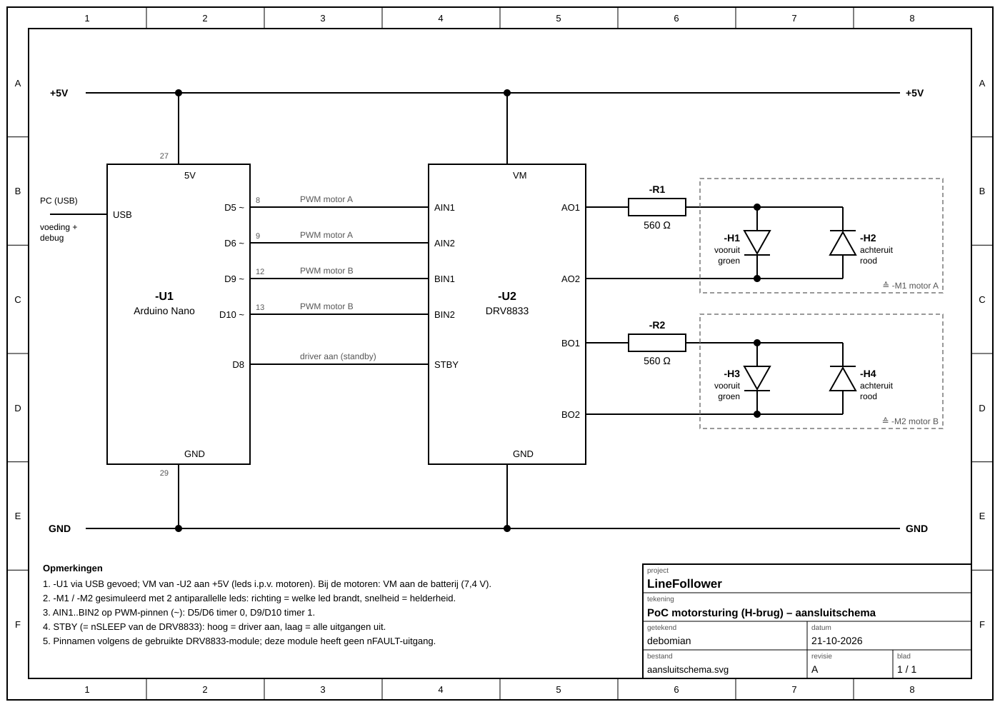

# H-Bridge proof of concept

minimale hard- & software + stappenplan dat aantoont dat 2 motoren onafhankelijk van elkaar kunnen draaien, en (traploos) regelbaar zijn in snelheid en draairichting.

## Wat testen we?
We testen of we met de DRV8833 de 2 motoren kunnen sturen:
* **elke motor apart** (onafhankelijk van elkaar)
* **sneller en trager** (traploos)
* **vooruit en achteruit**

In plaats van echte motoren gebruiken we **leds**. Zo kan de robot niet wegrijden tijdens het testen.
Per motor zijn er 2 leds:
* led 1 brandt = **vooruit**
* led 2 brandt = **achteruit**
* hoe feller de led, hoe **sneller** de motor zou draaien
* beide uit = **stil**

## Wat heb je nodig?
* Arduino Nano + USB-kabel
* DRV8833 module
* 4 leds in 2 kleuren (bv. 2× groen of geel voor vooruit, 2× rood voor achteruit)
* 2 weerstanden van 560 Ω

## Aansluiten


|Nano|DRV8833 module|wat doet het|
|----|--------------|------------|
|D5|AIN1|motor A|
|D6|AIN2|motor A|
|D9|BIN1|motor B|
|D10|BIN2|motor B|
|D8|STBY|driver aan zetten|
|5V|VM|voeding (enkel voor deze test met leds)|
|GND|GND||

**Leds per motor** (motor A op AO1/AO2, motor B op BO1/BO2):
```
AO1 ──[560 Ω]──┬── led vooruit  (lange poot hier) ──┬── AO2
               └── led achteruit (korte poot hier) ──┘
```
De 2 leds staan dus **omgekeerd naast elkaar**. Zo brandt de ene als de stroom de ene kant op gaat, en de andere als hij de andere kant op gaat. Voor motor B is het hetzelfde op BO1/BO2.

## Hoe werkt het?
* Elke motor heeft 2 ingangen op de DRV8833 (bv. AIN1 en AIN2).
  * signaal op AIN1 → **vooruit**
  * signaal op AIN2 → **achteruit**
  * op geen van beide → **stil**
* Het signaal is **PWM**: heel snel aan/uit schakelen. Hoe langer "aan", hoe sneller. Daarom zitten alle 4 de ingangen op een PWM-pin (pinnen met ~).
* In de code geef je per motor een snelheid van **-255** (vol achteruit) tot **255** (vol vooruit). 0 = stil.
* Bij het opstarten loopt een **demo**: motor A en B gaan elk in een **ander tempo** van vooruit naar achteruit en terug. Zo zie je dat ze los van elkaar werken.

Code: [hbridge/hbridge.ino](hbridge/hbridge.ino) (library `SerialCommands` nodig).

Commando's in de seriële monitor (9600 baud, `Newline`):

|typ|wat gebeurt er|
|---|--------------|
|`a 128`|motor A half vooruit|
|`a -255`|motor A vol achteruit|
|`b 200`|motor B vooruit|
|`stop`|alles stil|
|`demo`|demo terug starten|

## Testen
1. Sluit alles aan en upload de code (bord: Arduino Nano, processor: ATmega328P (Old Bootloader)).
2. **Demo**: de leds van motor A en B wisselen elk in hun eigen tempo van kleur.
   ✔ beide motoren werken, in beide richtingen, los van elkaar.
3. Open de seriële monitor (9600 baud, `Newline`) en typ `stop`.
   ✔ alle leds uit.
4. Typ `a 50`, dan `a 128`, dan `a 255`.
   ✔ de vooruit-led van motor A wordt telkens feller → traploos regelbaar.
5. Typ `a -128`.
   ✔ nu brandt de achteruit-led van motor A → andere richting.
6. Typ `b 255`.
   ✔ motor B gaat vol vooruit, motor A verandert niet → onafhankelijk.
7. Typ `stop` en dan `demo` om de demo terug te starten.
8. Alles ok? Vervang de leds door de echte N20 motoren en zet VM op de batterij. Draait een motor de verkeerde kant op: draai de 2 draadjes van die motor om.

## Let op
* VM op 5 V van de Nano is **enkel voor de leds**. Met de echte motoren moet VM aan de **batterij**.
* Bij een lage snelheid (onder ± 30) zie je de led bijna niet. Dat is normaal.
* Deze DRV8833 module heeft geen pin die fouten meldt (geen nFAULT).
* De NC-pinnen op de module laat je gewoon leeg.
