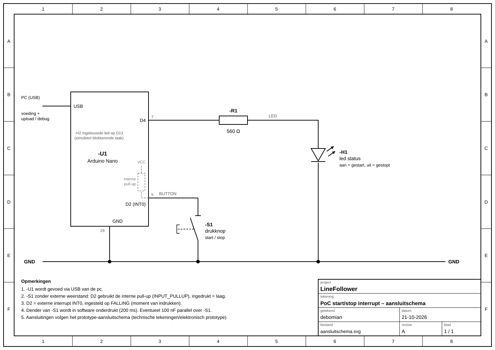

# start/stop interrupt proof of concept
minimale hard- en software die de correcte werking van een start/stop drukknop aantoont, gebruik makend van een hardware interrupt.

## Wat testen we?
Met een drukknop zetten we de robot op "gestart" of "gestopt". Dat moet **meteen** reageren, ook als de Arduino op dat moment met iets anders bezig is.
Om dat te testen laten we de Arduino expres traag knipperen (met `delay`), en kijken we of de knop toch direct werkt.

## Wat heb je nodig?
* Arduino Nano + USB-kabel
* 1 drukknop
* 1 led + weerstand van 560 Ω

## Aansluiten

|Nano|gaat naar|
|----|---------|
|D2|drukknop, andere kant van de knop naar GND|
|D4|560 Ω → lange poot van de led, korte poot naar GND|
|D13|niks, dit is de led op de Nano zelf|

Er is geen extra weerstand nodig voor de knop: de Nano heeft er één ingebouwd (`INPUT_PULLUP`).

## Hoe werkt het?
* **Led op D13** (op de Nano): knippert traag. Dit stelt "de rest van het programma" voor, dat druk bezig is.
* **Drukknop op D2**: D2 is een speciale pin die een **interrupt** kan geven. Als je drukt, stopt de Arduino even met wat hij doet, voert de knop-functie uit, en gaat daarna verder.
* **Led op D4**: toont de toestand. Aan = gestart, uit = gestopt. Elke druk wisselt de toestand.
* Een knop "dendert": bij één druk geeft hij soms een paar snelle pulsen. Daarom negeert de code een tweede druk binnen 200 ms.

Code: [interrupt/interrupt.ino](interrupt/interrupt.ino) (geen extra library nodig).

## Testen
1. Sluit alles aan en upload de code (bord: Arduino Nano, processor: ATmega328P (Old Bootloader)).
2. De led op de Nano (D13) knippert traag.
3. Druk op de knop.
   ✔ de led op D4 gaat **meteen** aan, het maakt niet uit waar het knipperen zit.
4. Druk opnieuw.
   ✔ de led op D4 gaat meteen uit.
5. Extra: open de seriële monitor (9600 baud). `gestart` / `gestopt` verschijnt pas iets later dan dat de led wisselt. Dat is net het verschil: de knop werkt direct, de rest van het programma pas als het klaar is met wachten.

## Let op
* Enkel **D2 en D3** kunnen op de Nano een interrupt geven.
* Wisselt de led soms ook bij het loslaten van de knop? Zet dan een condensator van 100 nF over de knop.
* Een drukknop met 4 pootjes: sluit hem **schuin** (diagonaal) aan, dan zit je zeker juist.
