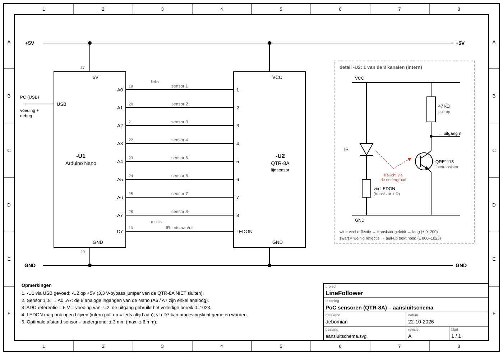

# Sensoren proof of concept

minimale hard- en software die aantoont dat minimaal 6 sensoren onafhankelijk van elkaar kunnen uitgelezen worden (geen calibratie, normalisatie of interpolatie). Hierbij moet een zo groot mogelijk bereik van de AD converter benut worden (indien van toepassing)

## Wat testen we?
We lezen de **8 sensoren** van de QTR-8A elk apart uit en tonen de waarden op de pc.
We kijken of:
* elke sensor reageert op een zwarte lijn, **los van de andere**
* het verschil tussen wit en zwart zo **groot** mogelijk is

We doen bewust nog **niks** met de waarden (geen calibratie). Dat komt pas in het finale programma.

## Wat heb je nodig?
* Arduino Nano + USB-kabel
* QTR-8A sensor
* wit blad papier + zwarte tape (bv. isolatietape)

## Aansluiten


|QTR-8A|Nano|
|------|----|
|1 … 8|A0 … A7 (1 = links, 8 = rechts)|
|LEDON|D7|
|VCC|5V|
|GND|GND|

De sensor werkt op 5 V: de 3,3 V-jumper op de sensor **niet** dichtsolderen.

## Hoe werkt het?
* Elke sensor heeft een **IR-ledje** en een **lichtsensor** naast elkaar.
* Het ledje schijnt op de grond. De lichtsensor meet hoeveel licht er terugkomt.
  * **wit** → veel licht terug → **lage waarde** (± 0 – 200)
  * **zwart** → weinig licht terug → **hoge waarde** (± 800 – 1023)
* De Arduino meet de spanning van elke sensor op A0 – A7 en maakt er een getal van **0 tot 1023** van.
* 10× per seconde stuurt hij de 8 waarden naar de pc, bv.:
  ```
  s1:45 s2:52 s3:961 s4:880 s5:60 s6:48 s7:55 s8:50
  ```
  Hier liggen sensor 3 en 4 boven de zwarte lijn.

Code: [sensor/sensor.ino](sensor/sensor.ino) (library `SerialCommands` nodig).

Commando's in de seriële monitor (9600 baud, `Newline`):

|typ|wat gebeurt er|
|---|--------------|
|`uit`|IR-ledjes uit: je meet enkel het licht in de kamer|
|`aan`|IR-ledjes terug aan|

**Zo krijgen we een groot bereik:**
* De Arduino meet tot 5 V, en de sensor geeft ook tot 5 V → we gebruiken het volledige bereik 0 – 1023.
* Houd de sensor op **± 3 mm** van de grond. Hoger = minder verschil tussen wit en zwart.

## Testen
1. Sluit alles aan en upload de code (bord: Arduino Nano, processor: ATmega328P (Old Bootloader)).
2. Open de **seriële monitor** (9600 baud, `Newline`). Je ziet elke 100 ms een regel met 8 waarden.
3. Leg de sensor op een **wit blad** (± 3 mm hoog).
   ✔ alle waarden zijn laag.
4. Schuif de **zwarte tape** van links naar rechts onder de sensor.
   ✔ de waarde boven de tape wordt hoog, **één voor één** van s1 naar s8 → elke sensor werkt apart.
5. Open in plaats van de monitor **Tools → Serial Plotter**. Nu zie je elke sensor als een lijn in een grafiek. Doe stap 4 opnieuw en kijk hoe de piek van links naar rechts schuift.
6. Typ `uit`: de waarden worden hoog, ook op wit (geen IR-licht meer). Typ `aan` om terug te gaan.
7. Noteer per sensor de waarde op wit en op zwart:

|sensor|wit|zwart|
|------|---|-----|
|s1| | |
|s2| | |
|s3| | |
|s4| | |
|s5| | |
|s6| | |
|s7| | |
|s8| | |

✔ groot verschil (bv. ± 50 op wit, ± 950 op zwart) = het bereik wordt goed gebruikt.

## Let op
* Sensor in de lucht (zonder ondergrond) geeft geen bruikbare waarden: dan meet je vooral het licht in de kamer.
* Niet elke sensor geeft exact dezelfde waarden. Dat is normaal en lossen we later op met **calibratie** in het finale programma.
* LEDON mag ook los blijven, dan staan de IR-ledjes altijd aan.
* Krijg je rare tekens in de seriële monitor? Zet de snelheid op **9600 baud**.
