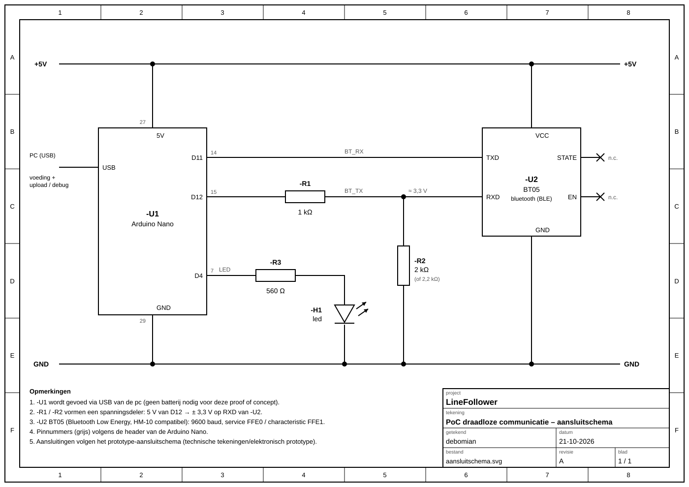

# draadloze communicatie proof of concept
minimale hard- en software waarmee aangetoond wordt dat duplex kan gecommuniceerd worden tussen de microcontroller en een smartphone (iPhone), gebruik makend van de app LightBlue.

## Wat testen we?
We sturen vanaf de gsm een commando naar de Arduino via bluetooth. De Arduino zet daarmee een led aan of uit en stuurt een antwoord terug.
Zo zien we dat berichten **in beide richtingen** werken (gsm → Arduino en Arduino → gsm).

## Wat heb je nodig?
* Arduino Nano + USB-kabel
* BT05 bluetooth module
* weerstanden: 1 kΩ en 2 kΩ (of 2,2 kΩ) voor de spanningsdeler
* 1 led + weerstand van 560 Ω
* iPhone met de gratis app **LightBlue**

## Aansluiten

|Nano|gaat naar|
|----|---------|
|5V|VCC van de BT05|
|GND|GND van de BT05, de led en de 2 kΩ|
|D11|TXD van de BT05|
|D12|1 kΩ → RXD van de BT05, en van RXD een 2 kΩ naar GND|
|D4|560 Ω → lange poot van de led, korte poot naar GND|

Waarom de 1 kΩ en 2 kΩ? De Nano geeft 5 V, maar de BT05 mag maar 3,3 V krijgen op RXD. De 2 weerstanden verlagen de spanning.

## Hoe werkt het?
* De BT05 werkt als een **draadloze kabel**: wat de gsm stuurt, komt als tekst binnen op D11.
* De code kijkt welk woord er binnenkomt:
  * `aan` → led aan
  * `uit` → led uit
  * `status` → niks veranderen, enkel de toestand terugsturen
* Na elk commando stuurt de Arduino `led: aan` of `led: uit` terug naar de gsm.

Code: [wireless_communication/wireless_communication.ino](wireless_communication/wireless_communication.ino) (library `SerialCommands` nodig).

## Testen
1. Sluit alles aan en upload de code (bord: Arduino Nano, processor: ATmega328P (Old Bootloader)).
2. Open **LightBlue** op de iPhone en tik op **BT05**. De led op de BT05 stopt met knipperen = verbonden.
3. Tik op **FFE1** en zet rechtsboven het formaat op **UTF-8 String**.
4. Tik op **Listen for notifications** om de antwoorden te zien.
5. Tik op **Write new value**, typ `aan` en verstuur.
   ✔ de led gaat aan en je krijgt `led: aan` terug.
6. Verstuur `uit`.
   ✔ de led gaat uit en je krijgt `led: uit` terug.

## Let op
* De BT05 is **Bluetooth Low Energy**. Daardoor werkt hij met een gsm-app, maar **niet** met PuTTY of de seriële monitor op de pc.
* Je hoeft de BT05 niet te koppelen in de instellingen van de gsm, verbinden gebeurt in de app.
* De BT05 zit op D11/D12 en niet op D0/D1, zo kan je uploaden zonder hem los te koppelen.
* De commando's zijn met kleine letters.
