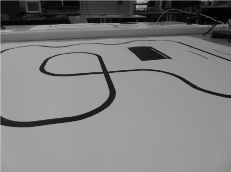

# LineFollower

Lijnvolger gebouwd als syntheseproject Elektromechanica – Automatisering (HOGENT).
De robot volgt een zwarte lijn op wit papier met 8 IR-sensoren en een PID-regeling. Instellingen worden opgeslagen in EEPROM en kunnen draadloos aangepast worden via bluetooth (BLE) vanaf een smartphone.

De printplaat (PCB) is meteen ook het chassis: motoren, batterij en sensoren worden rechtstreeks op de print gemonteerd.

## specifications

microcontroller: ATmega32U4-AU, 16 MHz, native USB (Arduino Leonardo-compatibel)

motors: 2× N20 micro gearmotor 30:1, 6 V, ± 1000 rpm onbelast

h-bridge: DRV8833 (dual H-brug, 2 kanalen)

sensors: 8× QRE1113GR reflectiesensor, IR-leds schakelbaar via MOSFET (meting tegen omgevingslicht)

batteries: 2S Li-Ion 7,4 V, 2000 mAh

wireless communication: BT05 (Bluetooth Low Energy 4.0, HM-10 compatibel), bediening via iPhone

distance sensor - motors: ± 82 mm (sensorlijn tot wielas)

weight: nog te bepalen

speed: doel ≥ 1 m/s (theoretisch ± 1,8 m/s onbelast met wielen van 28,6 mm)

kostprijs: ± € 43,30 per robot, zonder productie van de PCB (zie [bill of materials](bill%20of%20materials/readme.md))

## inhoud van deze repository

|map|inhoud|
|---|------|
|[bill of materials](bill%20of%20materials/readme.md)|onderdelenlijst en kostprijsberekening|
|[datasheets](datasheets/readme.md)|datasheets van de gebruikte componenten|
|[technische tekeningen](technische%20tekeningen)|elektronisch schema, PCB en mechanische tekeningen|
|[code/proof of concepts](code/proof%20of%20concepts/readme.md)|kleine testprogramma's die aantonen dat elk onderdeel werkt (motorsturing, sensoren, draadloze communicatie, start/stop interrupt)|
|[code/basis](code/basis/readme.md)|basisprogramma (parameters, EEPROM, start/stop, draadloze communicatie)|
|[code/test](code/test/readme.md)|testprogramma om elk onderdeel van de PCB apart te testen|
|[code/finaal](code/finaal/readme.md)|finaal programma van de lijnvolger|
|[gebruiksaanwijzing](gebruiksaanwijzing/readme.md)|hoe de lijnvolger gebruiken en instellen|
|[parcours](parcours/readme.md)|testparcours|
|[instructable](instructable/readme.md)|bouwhandleiding|
