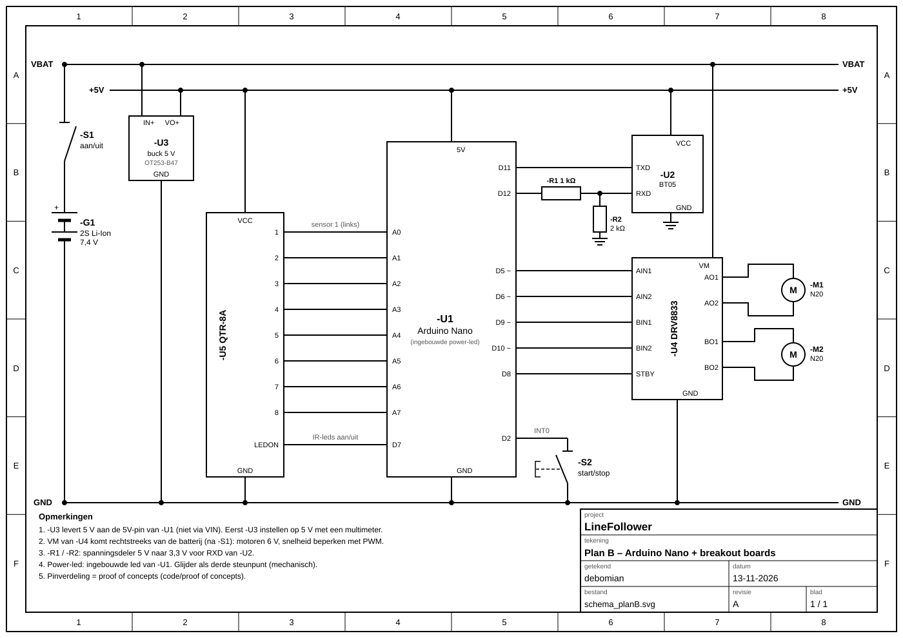
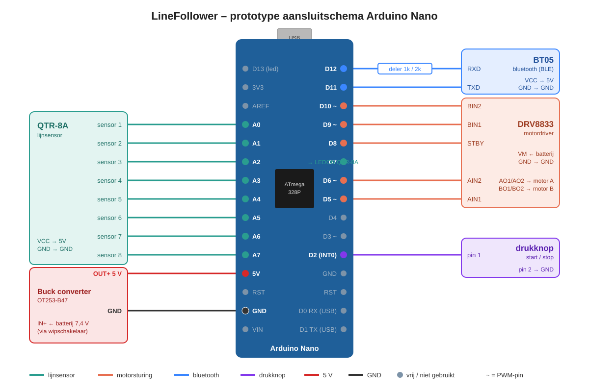

# plan B: elektronisch prototype – Arduino Nano + breakout boards

Testopstelling (breadboard) om de proof of concepts op te bouwen: welke pin van de Arduino Nano naar welke component gaat.
De opstelling gebruikt een Arduino Nano en breakout boards (BT05, DRV8833-module, QTR-8A, buck converter).

> **Prototype vs. PCB**
> Dit elektrisch prototype zou functioneel kunnen werken als lijnvolger. Toch is ervoor gekozen om een **eigen PCB** te ontwerpen, om de functionaliteit te kunnen garanderen: geen losse draden of breadboard-contacten die los kunnen trillen, korte en vaste verbindingen, en een print die meteen ook het chassis is.
> Het prototype blijft hier staan als basis voor de [proof of concepts](../../code/proof%20of%20concepts/readme.md). Het schema en de PCB van de eigenlijke lijnvolger staan in [elektronisch](../elektronisch/readme.md).

## schema plan B

Volledig schema met voeding: batterij → aan/uit-schakelaar → buck converter (5 V) voor de logica, en rechtstreeks naar VM van de motordriver. De onderdelen staan in de [BOM plan B](../../bill%20of%20materials/readme.md#plan-b-arduino-nano--breakout-boards).



## aansluitschema Arduino Nano



## pinout overzicht

|Nano pin|functie|component|pin component|richting|
|--------|-------|---------|-------------|--------|
|A0|sensor 1 (links)|QTR-8A|1|ingang (analoog)|
|A1|sensor 2|QTR-8A|2|ingang (analoog)|
|A2|sensor 3|QTR-8A|3|ingang (analoog)|
|A3|sensor 4|QTR-8A|4|ingang (analoog)|
|A4|sensor 5|QTR-8A|5|ingang (analoog)|
|A5|sensor 6|QTR-8A|6|ingang (analoog)|
|A6|sensor 7|QTR-8A|7|ingang (analoog)|
|A7|sensor 8 (rechts)|QTR-8A|8|ingang (analoog)|
|D2|start/stop drukknop (INT0)|drukknop|–|ingang (interne pull-up)|
|D5|motor A – PWM|DRV8833|AIN1|uitgang (PWM)|
|D6|motor A – PWM|DRV8833|AIN2|uitgang (PWM)|
|D7|IR-leds lijnsensor aan/uit|QTR-8A|LEDON|uitgang|
|D8|motordriver aan/uit|DRV8833|STBY|uitgang|
|D9|motor B – PWM|DRV8833|BIN1|uitgang (PWM)|
|D10|motor B – PWM|DRV8833|BIN2|uitgang (PWM)|
|D11|bluetooth RX (SoftwareSerial)|BT05|TXD|ingang|
|D12|bluetooth TX (SoftwareSerial)|BT05|RXD (via spanningsdeler)|uitgang|
|D13|status led (ingebouwd)|–|–|uitgang|

Vrij voor later: D3 (PWM / INT1), D4, D0/D1 (USB-serial, vrijhouden om te kunnen uploaden).

## keuze van de pinnen

### QTR-8A lijnsensor → A0 – A7

De QTR-8A heeft 8 analoge uitgangen. De Nano heeft precies 8 analoge ingangen (A0 – A7), dus elke sensor krijgt zijn eigen ADC-ingang.
A6 en A7 zijn op de Nano **enkel analoog** bruikbaar (geen digitale I/O), dus ze zijn hier optimaal benut.
De sensoren worden in volgorde aangesloten (sensor 1 → A0 … sensor 8 → A7), zodat de positieberekening in de code eenvoudig blijft.

### DRV8833 motordriver → D5, D6, D9, D10 + D8

De DRV8833 heeft **geen aparte PWM-ingang**: snelheid en draairichting worden geregeld door PWM op de ingangen zelf.
Daarom moeten **alle vier** de ingangen (AIN1, AIN2, BIN1, BIN2) op een PWM-pin.

|AIN1|AIN2|motor A|
|----|----|-------|
|PWM|0|vooruit, snelheid = duty cycle|
|0|PWM|achteruit, snelheid = duty cycle|
|0|0|uitbollen (coast)|
|1|1|remmen (brake)|

(idem voor BIN1/BIN2 en motor B)

De Nano heeft 6 PWM-pinnen: D3, D5, D6, D9, D10, D11.

- **Motor A → D5 / D6** (timer 0, ± 980 Hz)
- **Motor B → D9 / D10** (timer 1, ± 490 Hz)
- Elke motor zit zo op één timer, dus beide ingangen van een motor hebben dezelfde PWM-frequentie.
- D3 blijft vrij omdat dit ook de tweede externe interrupt (INT1) is.

Eén extra verbinding maakt samen de **5 aansluitingen** van de motorsturing:

- **STBY → D8** (= nSLEEP van de DRV8833): hoog = driver actief, laag = driver uit (motoren gegarandeerd stil, bv. bij stop).

> De gebruikte module heeft de pinnen `AIN1 AIN2 BIN1 BIN2 STBY GND` (+ 2× NC) en `VM GND AO1 AO2 BO1 BO2 GND` (+ NC). Er is **geen nFAULT-uitgang**.

### BT05 bluetooth → D11 / D12

De BT05 (Bluetooth Low Energy) wordt via `SoftwareSerial` aangesloten in plaats van op D0/D1. D0/D1 worden gedeeld met de USB-verbinding, zodat uploaden anders telkens het loskoppelen van de BT05 vereist.

- **D11 (RX) ← TXD BT05**: rechtstreeks, de 3,3 V van de BT05 wordt door de Nano als hoog gelezen.
- **D12 (TX) → RXD BT05**: via een **spanningsdeler**, want de RXD-ingang van de BT05 is 3,3 V.

```
D12 ──[ 1 kΩ ]──┬── RXD (BT05)
                │
             [ 2 kΩ ]
                │
               GND          5 V × 2k / (1k + 2k) = 3,3 V
```

### drukknop start/stop → D2

D2 is externe interrupt **INT0**, zodat start/stop via `attachInterrupt()` direct reageert, ook als de loop bezig is.
De knop wordt aangesloten tussen D2 en GND, met de interne pull-up (`INPUT_PULLUP`): niet ingedrukt = hoog, ingedrukt = laag (interrupt op `FALLING`).
Zorg voor debounce in de code (bv. minimale tijd tussen twee drukken).

## voeding

```
batterij 2S (7,4 V) ── wipschakelaar ──┬── VM DRV8833 (motoren)
                                       │
                                       └── IN+ buck converter ── 5 V ──┬── 5V Nano
                                                                       ├── VCC QTR-8A
                                                                       └── VCC BT05
```

- Alle GND's (batterij, buck converter, Nano, DRV8833, QTR-8A, BT05) **verbinden**.
- De 5 V van de buck converter gaat naar de **5V-pin** van de Nano, niet naar VIN.
- **Buck converter eerst instellen op 5 V** (meten met multimeter) vóór de Nano aangesloten wordt.
- De QTR-8A werkt op 5 V: de 3,3 V-bypass jumper op de sensor **niet** sluiten.

## pin definities voor de code

```cpp
// QTR-8A lijnsensor
const uint8_t sensorPins[8] = {A0, A1, A2, A3, A4, A5, A6, A7};
const uint8_t LEDON  = 7;   // hoog = IR-leds aan

// DRV8833 motordriver
const uint8_t AIN1   = 5;   // motor A, PWM
const uint8_t AIN2   = 6;   // motor A, PWM
const uint8_t BIN1   = 9;   // motor B, PWM
const uint8_t BIN2   = 10;  // motor B, PWM
const uint8_t STBY   = 8;   // hoog = driver aan

// BT05 bluetooth (SoftwareSerial)
const uint8_t BT_RX  = 11;  // naar TXD van BT05
const uint8_t BT_TX  = 12;  // naar RXD van BT05 (via spanningsdeler)

// drukknop start/stop
const uint8_t BUTTON = 2;   // INT0, INPUT_PULLUP

// status led
const uint8_t LED    = 13;
```
